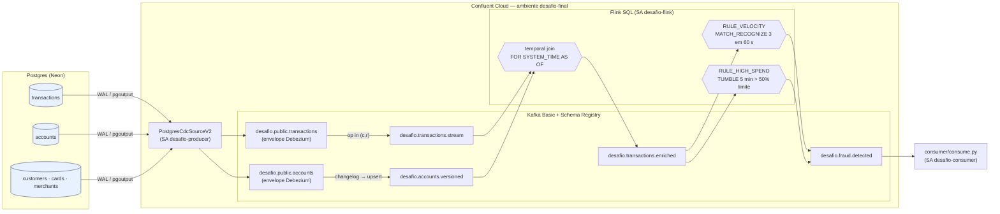

# Pipeline de pagamentos em tempo real — Postgres → CDC → Flink SQL → alerta de fraude

Transações de cartão nascem num Postgres (Neon), entram no Confluent Cloud por **CDC (Debezium)**, viram eventos **Avro** com contrato no **Schema Registry**, são **enriquecidas** com os dados da conta no **Flink SQL** e passam por **duas regras de fraude**. O alerta sai num tópico que uma aplicação consome.

O pipeline sobe com `./setup.sh` e cai com `./teardown.sh`. Todo comando abaixo foi rodado e a saída está em [`evidencias/`](evidencias/).



| Camada | O que roda | Script | Evidência |
|---|---|---|---|
| 1. Fundação | ambiente, cluster Basic, Schema Registry, 4 identidades com ACL/RBAC mínimos | `scripts/01_fundacao.sh` | [`01-fundacao.txt`](evidencias/01-fundacao.txt) |
| 2. Contrato | schema Avro `com.bootcamp.payments.Transaction`, BACKWARD, 1 mudança aceita e 2 recusadas | `scripts/02_contrato.sh` | [`02-contrato.txt`](evidencias/02-contrato.txt) |
| 3. Ingestão | `PostgresCdcSourceV2` lendo 5 tabelas; insert/update/delete viram eventos | `scripts/03_ingestao.sh` | [`03-ingestao.txt`](evidencias/03-ingestao.txt), [`03-envelopes-cdc.jsonl`](evidencias/03-envelopes-cdc.jsonl) |
| 4. Processamento | enriquecimento por temporal join + 2 regras de fraude | `scripts/04_processamento.sh` | [`04-processamento.txt`](evidencias/04-processamento.txt), [`04-alertas.jsonl`](evidencias/04-alertas.jsonl) |
| 5. Operação | métricas (Metrics API), acesso, custo, confiabilidade | `scripts/05_operacao.sh` | [`05-operacao.txt`](evidencias/05-operacao.txt) |

---

## Por que cada peça

| Peça | Escolha | Por quê |
|---|---|---|
| Banco de origem | **Neon** (Postgres serverless) | Grátis, endpoint público com TLS, liga replicação lógica com um clique. O conector gerenciado do Confluent precisa alcançar o banco pela internet. |
| Captura | **CDC (Debezium) e não batch** | Batch lê "o estado de agora" de tempos em tempos: perde estados intermediários (uma conta bloqueada e desbloqueada entre duas leituras some), chega com atraso do intervalo e martela o banco com `SELECT`. O CDC lê o WAL, que o banco já escreve de qualquer jeito: cada insert/update/delete vira um evento, em ordem, com o *antes* e o *depois*, em segundos. |
| Conector | **PostgresCdcSourceV2**, `pgoutput`, publication criada por nós | Totalmente gerenciado (nada para operar). `pgoutput` é nativo do Postgres (sem plugin). Com `publication.autocreate.mode=disabled`, o usuário do conector (`cdc_user`) só precisa de `SELECT` + `REPLICATION`: não é dono das tabelas nem tem `CREATE`. |
| Formato | **Avro + Schema Registry** | Mensagem binária compacta com o schema fora da mensagem; o registry recusa mudanças que quebram consumidores. Dinheiro é `decimal(15,2)` (nunca `float`), tempo é `timestamp-millis` (`time.precision.mode=connect`). |
| Compatibilidade | **BACKWARD** | Quem consome atualiza primeiro e continua lendo o histórico do tópico. É o padrão do Confluent e o que combina com "o consumidor relê dados antigos". |
| Processamento | **Flink SQL gerenciado** | A lógica inteira é SQL versionado em `sql/flink/`. Estado, checkpoint e exactly-once ficam por conta da plataforma. |
| Enriquecimento | **Temporal join** (`FOR SYSTEM_TIME AS OF`) em vez de join comum | O join comum guarda os dois lados para sempre e *reescreve* resultados antigos quando a conta muda: a saída deixa de ser append-only e as regras de janela/padrão não aceitam isso. O temporal join pega a versão da conta **vigente na hora da compra**, é determinístico se reprocessar e emite cada transação uma vez só. |
| Regra 1 | **`MATCH_RECOGNIZE` — 3 transações no mesmo cartão em < 60 s** | É uma janela realmente deslizante por cartão: `TUMBLE` de 60 s perde 2 compras às 10:00:59 + 1 às 10:01:01; `HOP` pega, mas gera o mesmo alerta em várias janelas. `WITHIN INTERVAL '60' SECOND` limita o estado e `AFTER MATCH SKIP PAST LAST ROW` faz 4 compras seguidas virarem 1 alerta, não 2. |
| Por que 60 s e 3 compras | o enunciado | Velocidade é o sinal clássico de cartão testado por robô (várias compras pequenas em sequência). Uma pessoa raramente passa o mesmo cartão 3 vezes em um minuto. |
| Regra 2 (evolução) | **`TUMBLE` de 5 min — 2+ compras somando > 50% do limite** | Outra janela e outro critério. Só existe por causa do enriquecimento (o limite vem da conta). A janela fixa é barata e não duplica alerta; o custo é a cegueira na borda, documentada e testada. |
| Tempo | **Tempo de evento** = `created_at` do banco, **watermark de 5 s** | O resultado depende de quando a compra aconteceu, não de quando o Flink a viu. 5 s cobrem o atraso típico do CDC sem segurar o alerta por muito tempo. |
| Ociosidade | `sql.tables.scan.idle-timeout=5s` no join | A tabela de contas quase não muda; sem isso o watermark dela para e o temporal join segura todas as transações. |
| Particionamento | chave = `card_id` | Todas as compras de um cartão na mesma partição, em ordem: é o que a regra por cartão precisa. |
| Saída | append-only, `alert_id` determinístico | Alerta é um fato. Se algo reprocessar, o consumidor deduplica por `alert_id` (regra + cartão + 1ª transação/janela). |

---

## Como subir do zero

### Pré-requisitos

- Conta no [Confluent Cloud](https://confluent.cloud) e no [Neon](https://neon.tech).
- [Confluent CLI](https://docs.confluent.io/confluent-cli/current/install.html) v4+, `jq`, `psql`, `curl`, Python 3.10+.
- Linux/macOS (no Windows, use WSL).

```bash
git clone https://github.com/<seu-usuario>/pipeline-pagamentos-confluent.git
cd pipeline-pagamentos-confluent
python3 -m venv .venv && source .venv/bin/activate
pip install -r generator/requirements.txt
confluent login --save
```

### 1. Preparar o Neon (5 minutos, pelo console)

1. Crie um projeto na **mesma região** do cluster (padrão: `aws / us-east-1`).
2. **Project settings → Logical Replication → Enable** (liga `wal_level=logical` no projeto inteiro e não tem volta; por isso vale um projeto só para o desafio).
3. **Roles → New role → `cdc_user`**. Guarde a senha. Papéis criados pelo console já vêm com `REPLICATION`.
4. Copie a connection string do dono (`neondb_owner`) **sem `-pooler`** no host: replicação lógica não passa pelo pooler.

### 2. Configurar

```bash
cp .env.example .env   # preencha DATABASE_URL e CDC_DB_*
```

### 3. Subir

```bash
./setup.sh             # camadas 1→4 (~15 min, quase tudo é esperar o cluster e o conector)
```

Cada camada pode ser rodada sozinha (`./setup.sh 3`) e é re-executável. O que já existe é reaproveitado, e IDs e chaves ficam em `.state/` (fora do Git).

### 4. Ver ao vivo

```bash
# terminal 1 — ~1 transação/s + uma rajada de fraude a cada 45 s
python3 generator/stream_transactions.py

# terminal 2 — os alertas chegando
python3 consumer/consume.py --topic desafio.fraud.detected --latest --timeout 300 \
  --out evidencias/04-alertas-ao-vivo.jsonl

# depois: cada fraude injetada virou alerta?
python3 consumer/compare_alerts.py --ao-vivo evidencias/04-alertas-ao-vivo.jsonl
./scripts/05_operacao.sh   # métricas e acesso com tráfego rodando
```

### 5. Derrubar tudo

```bash
./teardown.sh          # statements → pool → conector → slot no Postgres → SAs → cluster → ambiente
```

O teardown também **apaga o slot de replicação no Neon**. Um slot esquecido segura o WAL para sempre, enche o storage e impede a compute de dormir.

---

## Camada 1 — Fundação

**O que faz.** Cria o ambiente `desafio-final` (Stream Governance Essentials, que traz o Schema Registry), o cluster **Basic** `desafio-basic` e uma identidade por papel. A conta pessoal só cria e destrói.

| Identidade | Pode | Não pode | Por quê |
|---|---|---|---|
| `desafio-producer` | `CREATE/WRITE/DESCRIBE` em `desafio.public.*` e no heartbeat do Debezium; `DESCRIBE` no cluster | ler qualquer tópico; escrever fora de `desafio.public.*` | É a identidade do conector de CDC: só escreve o espelho do banco. |
| `desafio-consumer` | `READ/DESCRIBE` em `desafio.*`, grupos `desafio-*`; `DeveloperRead` nos subjects `desafio.*` | escrever qualquer coisa | Aplicação que lê alertas e eventos. |
| `desafio-flink` | `FlinkDeveloper`; lê `desafio.*`; escreve só em `desafio.accounts.*`, `desafio.transactions.*`, `desafio.fraud.*` | escrever no espelho do banco (`desafio.public.*`) | O processamento não pode adulterar a fonte. |
| `desafio-metrics` | `MetricsViewer` | ler dados | A chave de observabilidade não vê nenhuma transação. |

ACL e RBAC convivem aqui: as ACLs protegem os tópicos para conector e consumidor, e o RBAC é o que o Flink e o Schema Registry entendem.

> **📎 Evidência** — `confluent iam service-account list` e ACLs por identidade ([`evidencias/01-fundacao.txt`](evidencias/01-fundacao.txt))
>
> ```text
> PENDENTE: cole aqui os blocos "Service accounts do desafio" e "ACLs de sa-..." de evidencias/01-fundacao.txt
> ```

---

## Camada 2 — Contrato

**O que faz.** Registra [`schemas/transaction.v1.avsc`](schemas/transaction.v1.avsc) (namespace `com.bootcamp.payments`, `amount` como `bytes/decimal(15,2)`, `created_at` como `timestamp-millis`, campos marcados com `confluent:tags` **PII**/**PCI**) no subject `desafio.contract.transactions-value`, fixa **BACKWARD** e testa três evoluções:

| Versão | Mudança | Esperado | Por quê |
|---|---|---|---|
| v2 | `device_id` opcional, `default: null` | ✅ aceita | Quem lê com a v2 preenche o default nas mensagens antigas. |
| v3 | `risk_score` obrigatório **sem default** | ❌ recusa | A mensagem antiga não tem o campo e não há com o que preencher. |
| v4 | `transaction_id` de `long` para `int` | ❌ recusa | Estreitar o tipo: um `long` antigo pode não caber num `int`. |

Remover um campo **é permitido** em BACKWARD (o leitor novo só ignora o campo velho); quem quebra com a remoção é o FORWARD. Por isso o teste de rejeição usa um campo novo sem default e um tipo estreitado, e não uma remoção.

Os schemas dos tópicos de CDC e do Flink são registrados automaticamente pelo conector e pelo Flink, com a compatibilidade padrão do ambiente. O subject `contract` é o contrato canônico, escrito à mão, que a equipe revisa em PR.

> **📎 Evidência** — `test-compatibility` aceitando e recusando ([`evidencias/02-contrato.txt`](evidencias/02-contrato.txt))
>
> ```text
> PENDENTE: cole aqui as linhas "v2 ... is_compatible=true", "v3 ... is_compatible=false" (com o motivo),
>           "v4 ... is_compatible=false" e a resposta 409 da tentativa de registrar a v3
> ```

---

## Camada 3 — Ingestão (CDC)

**O que o conector precisa do banco** ([`sql/postgres/03_cdc_setup.sql`](sql/postgres/03_cdc_setup.sql)):

1. `wal_level = logical`: o WAL passa a ter informação suficiente para reconstruir as linhas.
2. Um papel com `REPLICATION` e só `SELECT` nas tabelas (`cdc_user`). O snapshot inicial é um `SELECT`; depois tudo vem do slot.
3. Uma **publication** (`desafio_pub`) dizendo quais tabelas vão para o stream.
4. `REPLICA IDENTITY FULL`: sem isso o `UPDATE`/`DELETE` chega com `before` só com a chave, e o Flink não consegue desfazer a versão antiga.
5. Um **slot** (`desafio_slot`), criado pelo próprio conector, que marca até onde o WAL já foi lido. É por ele que o conector retoma de onde parou.

**Dados.** [`sql/postgres/02_seed.sql`](sql/postgres/02_seed.sql) é gerado por [`generator/gen_seed.py`](generator/gen_seed.py) com **`seed=42`**: 200 clientes, 240 contas, 320 cartões, 60 lojas e 2000 transações. É determinístico e já traz fraudes plantadas no histórico. O gabarito está em [`generator/expected_alerts_seed.txt`](generator/expected_alerts_seed.txt).

**Configuração** em [`connectors/cdc.json`](connectors/cdc.json), sem segredos (`${CDC_DB_PASSWORD}` é preenchido do `.env` na hora de criar). Destaques: `output.data.format=AVRO`, `after.state.only=false` (envelope completo com `before`/`after`/`op`), `heartbeat.interval.ms=60000` (avança o slot mesmo sem mudança e evita acúmulo de WAL).

**Insert, update e delete viram eventos** ([`sql/postgres/04_cdc_demo.sql`](sql/postgres/04_cdc_demo.sql), conta 9001):

| Operação no banco | `op` | `before` | `after` |
|---|---|---|---|
| `INSERT` | `c` | `null` | linha nova (`ACTIVE`) |
| `UPDATE status='BLOCKED'` | `u` | linha antiga completa (graças ao `REPLICA IDENTITY FULL`) | linha nova (`BLOCKED`) |
| `DELETE` | `d` | última versão | `null`, seguido de um **tombstone** (valor nulo) para a compactação |

> **📎 Evidência** — os três envelopes da conta 9001 ([`evidencias/03-envelopes-cdc.jsonl`](evidencias/03-envelopes-cdc.jsonl)) e o conector `RUNNING` ([`evidencias/03-ingestao.txt`](evidencias/03-ingestao.txt))
>
> ```json
> PENDENTE: cole aqui as linhas op=c, op=u, op=d e o tombstone de evidencias/03-envelopes-cdc.jsonl
> ```

---

## Camada 4 — Processamento (Flink SQL)

Os statements estão em [`sql/flink/`](sql/flink/), um por arquivo, na ordem em que rodam. Os `NN_ddl_*` rodam uma vez com a conta pessoal; os `NN_dml_*` são contínuos e rodam com a service account `desafio-flink`.

| # | Statement | O que faz |
|---|---|---|
| 01 | `ALTER TABLE desafio.public.transactions` | Lê o envelope cru em modo **append**. Transação é um fato que só nasce, e as regras precisam de append-only. |
| 10 | `→ desafio.accounts.versioned` | CDC de contas (changelog) → tabela upsert com PK `account_id` e watermark em `updated_at`. |
| 11 | `→ desafio.transactions.stream` | `op IN ('c','r')` → fluxo de transações com tempo de evento e watermark de 5 s. |
| 12 | `→ desafio.transactions.enriched` | **Temporal join**: transação + `customer_id`, `status`, `credit_limit`, `risk_tier` da conta na versão vigente em `created_at`. |
| 13 | `RULE_VELOCITY → desafio.fraud.detected` | `MATCH_RECOGNIZE`, `PARTITION BY card_id`, `PATTERN (T{3}) WITHIN INTERVAL '60' SECOND`. |
| 14 | `RULE_HIGH_SPEND → desafio.fraud.detected` | `TUMBLE` de 5 min, `HAVING COUNT(*) >= 2 AND SUM(amount) > credit_limit * 0.5`. |

**Prova.** O seed tem fraudes plantadas e o [`consumer/compare_alerts.py`](consumer/compare_alerts.py) confere regra, cartão e IDs de transação de cada alerta contra o gabarito:

```text
RULE_VELOCITY   card_id=73  transaction_ids=[1390, 1391, 1393]   (3 compras em 31 s)
RULE_VELOCITY   card_id=96  transaction_ids=[583, 584, 585]      (4 compras em 50 s → 1 alerta só)
RULE_HIGH_SPEND card_id=253 transaction_ids=[1613, 1614]         (2 × 30% do limite de R$ 20.000)
RULE_HIGH_SPEND card_id=80  transaction_ids=[1765, 1767]
RULE_HIGH_SPEND card_id=255 transaction_ids=[25, 27]
```

> **📎 Evidência** — o alerta no tópico `desafio.fraud.detected` e as 3 transações do mesmo `card_id` em menos de 60 s que o dispararam ([`evidencias/04-alertas.jsonl`](evidencias/04-alertas.jsonl), [`evidencias/04-processamento.txt`](evidencias/04-processamento.txt))
>
> ```json
> PENDENTE: cole aqui o alerta RULE_VELOCITY do card_id=73 (com transaction_ids, first_tx_at, last_tx_at)
> ```
>
> ```text
> PENDENTE: cole aqui a saída de compare_alerts.py (5/5 alertas esperados encontrados)
> ```

> **📎 Evidência ao vivo** — uma fraude injetada pelo gerador virando alerta
>
> ```text
> PENDENTE: cole a linha "[FRAUDE INJETADA] RULE_VELOCITY card_id=..." do gerador e o alerta correspondente
> ```

---

## Camada 5 — Operação

### 1. Observabilidade

Consulta à **Metrics API** com a chave da `desafio-metrics` (só `MetricsViewer`): pico de `received_bytes` por tópico e *consumer lag* por grupo na última hora. A saúde do conector, dos statements e o WAL retido no slot também são conferidos.

> **📎 Evidência** ([`evidencias/05-operacao.txt`](evidencias/05-operacao.txt))
>
> ```text
> PENDENTE: cole os blocos "Pico de received_bytes por tópico" e "Consumer lag por grupo"
> ```

Os sinais que eu alarmaria em produção: conector diferente de `RUNNING`, WAL retido no slot crescendo (o conector parou de ler), statement Flink diferente de `RUNNING`, e o *watermark lag* do statement 13 (alerta atrasado é alerta inútil).

### 2. Segurança

A matriz está na [Camada 1](#camada-1--fundação). Além dela:

- Nenhum segredo versionado. `.env` e `.state/` estão no `.gitignore`, a config do conector é renderizada em `.state/` com permissão `600` e o `scripts/check_entrega.sh` procura padrões de senha/chave nos arquivos versionados.
- `cdc_user` só lê, e só as 5 tabelas da publication.
- Os campos sensíveis estão marcados com tags `PII`/`PCI` no contrato. O cartão só aparece como `pan_last4`; o PAN nunca entra no pipeline.

### 3. Custo

> **📎 Evidência** — `confluent billing cost list` do período ([`evidencias/05-operacao.txt`](evidencias/05-operacao.txt))
>
> ```text
> PENDENTE: cole a saída de "./scripts/05_operacao.sh custo" (rodado 1-3 dias depois do teardown)
> ```

| Item | Custo no período |
|---|---|
| Kafka Basic (throughput + storage) | PENDENTE |
| Conector PostgresCdcSourceV2 (task-hora + throughput) | PENDENTE |
| Flink (CFU-minuto) | PENDENTE |
| Schema Registry (Essentials) | PENDENTE |
| Neon | PENDENTE (plano free) |
| **Total** | **PENDENTE** |

Duas alavancas:

1. **Flink é cobrado por CFU enquanto o statement roda.** São 5 statements contínuos, e eles ocupam CFU mesmo com pouco tráfego. Para demo, rodar só durante a gravação e derrubar; em produção, juntar as duas regras num statement só (`STATEMENT SET`) e limitar `max-cfu`.
2. **O conector cobra por hora de task, mesmo sem mudança no banco.** Capturar só as tabelas que o Flink usa (`accounts`, `transactions`) em vez das 5 corta throughput e storage. Um teardown no fim do dia zera conector, cluster Basic e Flink, e deixa o Neon voltar a dormir.

### 4. Confiabilidade — ponta a ponta

| Trecho | Garantia | Como | Onde pode duplicar/perder |
|---|---|---|---|
| Postgres → conector | at-least-once | O slot guarda o LSN confirmado; ao reiniciar, o conector relê a partir dele. | Pode **reenviar** eventos depois de uma falha. Não perde enquanto o slot existir. |
| Conector → Kafka | at-least-once, durável | Tópicos com replicação 3 no Confluent Cloud. | Duplicatas do trecho anterior passam adiante. |
| Kafka → Flink → Kafka | **exactly-once** | Checkpoints + escrita transacional (`_confluent-flink_*`). | Uma duplicata *de origem* ainda vira duas linhas (mesmo `transaction_id`). |
| `desafio.fraud.detected` → consumidor | at-least-once | Leitura `read_committed` (padrão do librdkafka): só vê o que o Flink confirmou. O `consume.py` de exemplo não commita offset (relê do início); uma aplicação real commita depois de processar. | Reprocessa após falha. |
| **Consumidor → efeito** (bloquear cartão, avisar cliente) | **depende da aplicação** | Deduplicar por `alert_id`, que é determinístico. | **Elo fraco**: a idempotência é código da aplicação, não da plataforma. |

---

## Custo e teardown

- **Custo declarado:** PENDENTE (ver [Camada 5 → Custo](#3-custo)).
- **Derrubado com** `./teardown.sh`.

> **📎 Evidência** — nada sobrou ([`evidencias/99-teardown.txt`](evidencias/99-teardown.txt))
>
> ```text
> PENDENTE: cole "connect cluster list" e "flink statement list" retornando None found,
>           as service accounts desafio-* inexistentes e o slot removido do Postgres
> ```

---

## Estrutura

```
.
├── setup.sh / teardown.sh         # sobe / derruba tudo
├── .env.example                   # modelo de configuração (o .env real não é versionado)
├── scripts/
│   ├── 01_fundacao.sh … 05_operacao.sh
│   ├── lib.sh                     # funções comuns
│   └── check_entrega.sh           # checklist de entrega automatizado
├── connectors/cdc.json            # config do PostgresCdcSourceV2 (sem segredos)
├── schemas/transaction.v*.avsc    # contrato + 3 evoluções
├── sql/
│   ├── postgres/                  # schema, seed (seed=42), setup do CDC, demo I/U/D, limpeza
│   └── flink/                     # 5 DDL + 5 DML, um statement por arquivo
├── generator/                     # gen_seed.py, stream_transactions.py, gabarito
├── consumer/                      # consume.py (Avro), compare_alerts.py
└── evidencias/                    # saídas reais de cada camada
```

## Quando trava

| Sintoma | Causa provável | O que fazer |
|---|---|---|
| Conector `FAILED`: *logical decoding requires wal_level >= logical* | replicação lógica desligada | Neon → Logical Replication → Enable. |
| Conector `FAILED`: *connection refused / timeout* | host com `-pooler` ou região/projeto errado | Use o endpoint direto em `CDC_DB_HOST`. |
| Conector `FAILED`: *must be superuser or replication role* | `cdc_user` criado por SQL, sem `REPLICATION` | Recrie o papel pelo console do Neon. |
| `UPDATE` chega com `before` só com a chave | faltou `REPLICA IDENTITY FULL` | Rode `sql/postgres/03_cdc_setup.sql`. |
| Statement 12 `RUNNING` mas sem saída | watermark parado na tabela de contas | Confira o `--property sql.tables.scan.idle-timeout=5s`. |
| Regras sem alerta ao vivo | sem tráfego, o watermark não anda e a janela não fecha | Deixe o `stream_transactions.py` rodando (ele mantém ~1 tx/s). |
| `consume.py` dá *authorization failed* logo após o setup | chave nova ainda propagando | Espere 1–2 min e rode de novo. |
| Statement DML falha com *not authorized* | role binding do `desafio-flink` ainda propagando | Rode `./setup.sh 4` de novo (é re-executável). |

## Evoluções

- [x] **Segunda regra de fraude**, com outra janela (`TUMBLE` 5 min) e outro critério (% do limite), em `sql/flink/14_dml_rule_high_spend.sql`.
- [ ] Evento com defeito numa fila separada (DLQ) em vez de parar o statement.
- [ ] Materializar `desafio.fraud.detected` como tabela **Apache Iceberg** com Tableflow.
- [ ] Pontuar o risco de cada transação com um modelo de IA (`ML_PREDICT`) no stream enriquecido.

## Checklist de entrega

```bash
./scripts/check_entrega.sh
```

Ele confere que não sobrou nenhum `PENDENTE` neste README, que cada camada tem arquivo de evidência, que `.env` e `.state/` não estão no Git, que nenhum padrão de senha/chave foi versionado e que o nome do repositório está em minúsculas e sem acento. Também imprime o link certo para enviar: o do repositório, não o de um arquivo.
